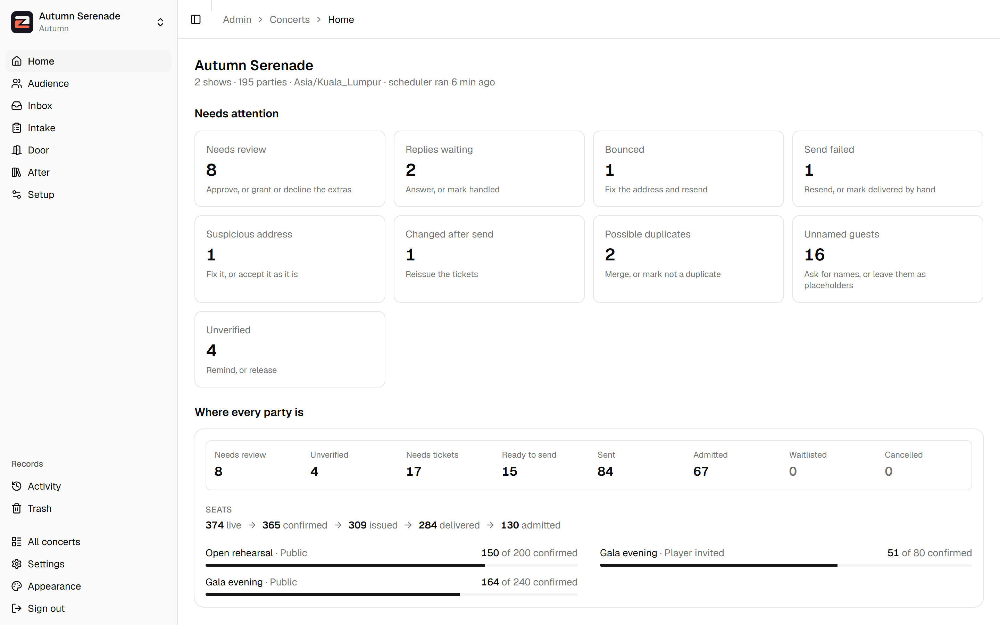
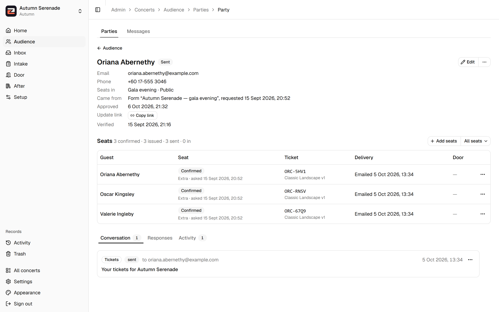
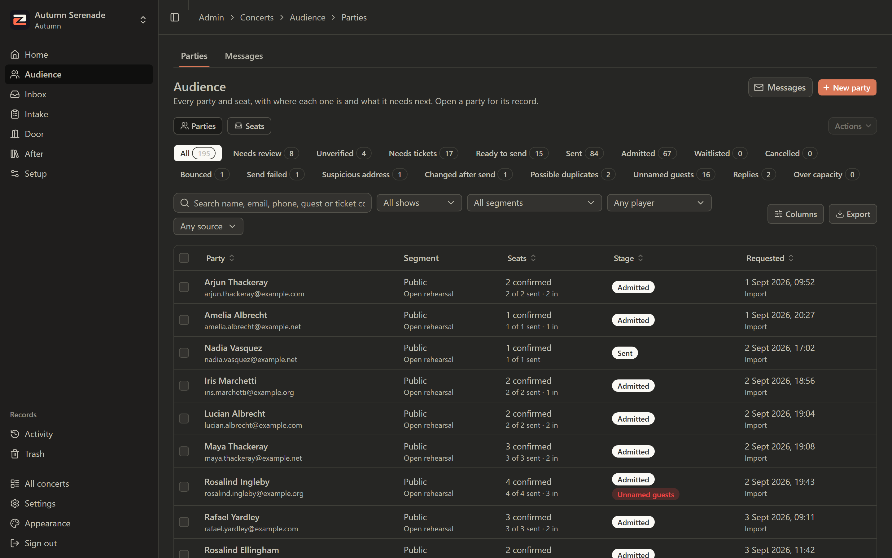
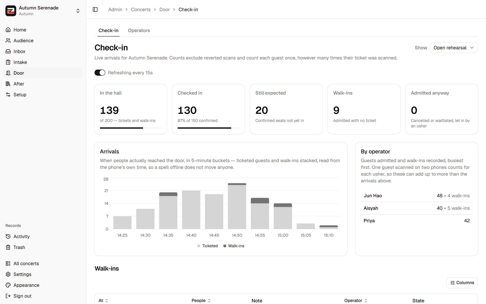
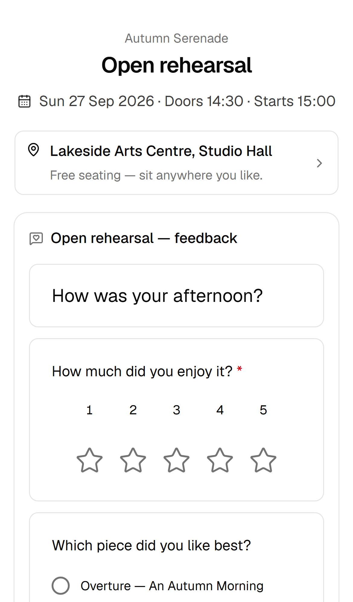
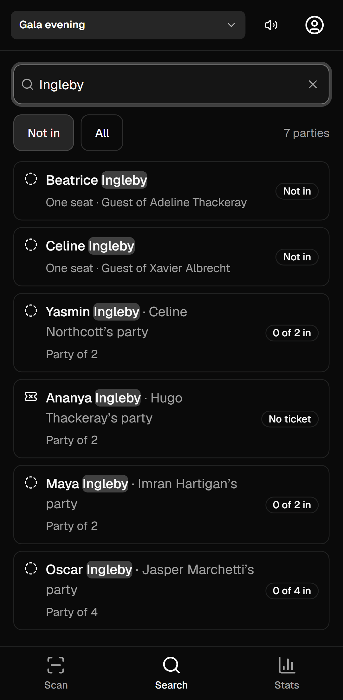
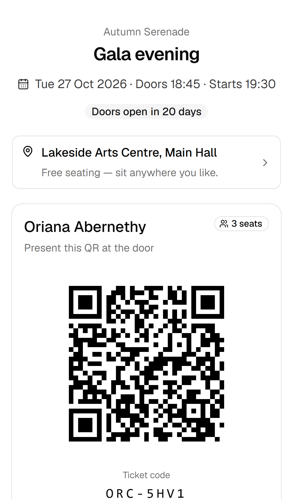
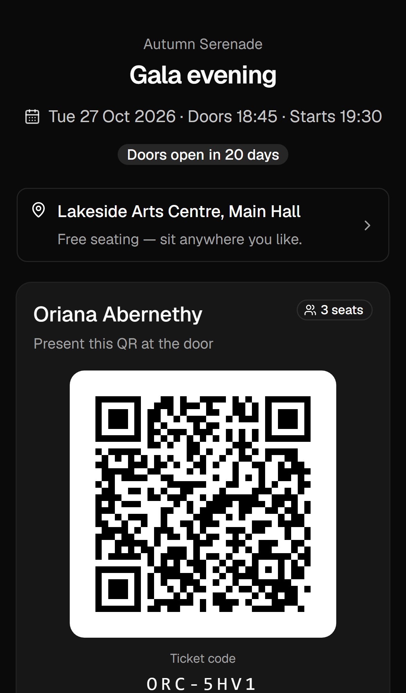

<p align="center">
  <picture>
    <source media="(prefers-color-scheme: dark)" srcset="public/brand/zetix-lockup-dark.png">
    
  </picture>
</p>

<p align="center">
  Ticketing for free concerts with unreserved seating: registration, seat allocation, tickets by
  email, and a door scanner that keeps working when the hall has no signal.
</p>

---

Zetix runs a concert from first registration to the last feedback form. Guests register as a
party, an admin reviews and allocates their seats, and each guest gets a ticket with its own QR code
and a personal page. Ushers scan them in on their phones. Nobody pays for anything. Version 1 ran a
chamber orchestra's concert in September 2026.



## What it does

- **Registration.** Public forms and player-invited forms, built in the console, or a spreadsheet
  import through a staging grid. A registration is a party of N: one email address, N tickets.
  Duplicates are flagged for merging, and suspicious addresses are flagged for checking.
- **Allocation.** Each show's hall is split into segments, public or player-invited, each with its
  own quota. Seats are claimed by one Postgres function that locks before it counts, so a show cannot
  be oversold. Extra seats beyond a quota wait for review.
- **Tickets.** A canvas editor for the ticket design, rendered to PDF. The design version is pinned
  when a ticket is issued, so editing the template never changes a ticket someone already holds.
- **Email.** A send wizard over an outbox. Pressing Send twice is harmless. An inbox reads replies and
  bounces back onto each party's record, and a `pg_cron` scheduler sends what is due.
- **The door.** A phone scanner that downloads the show's roster and admits guests from it offline. A
  QR is matched by pattern rather than opened as a link, so a dead URL cannot stop admission. It also
  handles search, walk-ins and a live dashboard for the front of house.
- **The guest's page.** Every ticket links to a page with the QR, directions and the programme
  booklet. After the show it has a feedback form and a wall of notes for the players.
- **The console.** Seven areas built around one record, the party. Its stage is derived, never stored.
  Work queues for what needs attention, commands that act on a whole selection, an activity log and a
  trash. Named admins, read-only viewers, and ushers who see only their assigned shows.

| | |
|---|---|
|  |  |
|  |  |

<p align="center">
  
  
  
</p>

## Try it

The demo is a fictional concert, *Autumn Serenade*: an open rehearsal that already happened and a
gala three weeks away. It has 195 parties at every stage, with replies, a bounce, duplicates and
walk-ins. You need Node 22, pnpm and Docker:

```bash
docker run -d --name zetix-test -p 55432:5432 -e POSTGRES_HOST_AUTH_METHOD=trust postgres:16
pnpm install
pnpm demo
```

`pnpm demo` creates and migrates a `zetix_demo` database, starts a stand-in for Supabase Auth, seeds the
concert and runs the app on <http://localhost:3100>. It prints the sign-ins: an admin, a read-only
viewer, and three ushers for the scanner at `/scan`. It reads nothing from `.env.local`, and the demo
has no mailbox, so nothing it does can send an email. After the first time, `docker start zetix-test`
brings the database back.

## How it is built

Next.js 16 (App Router, Server Actions) · Postgres on Supabase (Auth, Storage, `pg_cron`) · Drizzle ·
shadcn/ui and Tailwind · `react-konva`, `pdf-lib` and `sharp` for tickets · `@zxing/browser` at the
door · Gmail SMTP and IMAP · Vercel.

Some decisions worth reading:

- **Oversell is impossible, not unlikely.** `claim_seats()` takes a row lock on the show, counts and
  writes in one transaction. Its tests run against a real Postgres 16, never a mock, because a mock
  cannot hold a lock ([`allocation.md`](docs/spec/allocation.md) §7).
- **Every send is idempotent.** Mail is addressed per party and queued in an outbox with a partial
  unique index on pending rows, so a double click or a retried request cannot send twice
  ([`email.md`](docs/spec/email.md) §11.4).
- **The door does not need the network.** The scanner keeps an offline roster and queues its scans.
  An usher's account sees only the shows they are assigned to, and the roster endpoint checks that
  again in Postgres ([`checkin.md`](docs/spec/checkin.md) §12).
- **Nothing operational is in the code.** Capacities, quotas, deadlines, party caps and batch sizes
  are all entered in the console and resolve through a four-level cascade: segment, show, concert,
  system ([`spec/README.md`](docs/spec/README.md) §2.2).
- **Read-only means read-only.** Every page is readable by a viewer, every mutation refuses one, and
  values a viewer sees masked cannot be searched for. Tests call every action, route and page as a
  viewer.

[`docs/spec/`](docs/spec/README.md) is the full contract, one file per module, and
[`decisions.md`](docs/spec/decisions.md) records why each choice was made.

## Development

**Read `CLAUDE.md` first**, then `docs/spec/README.md` (the contract's index), `docs/modules.md`
(which branch owns what), `docs/context.md` (the concert's data), `docs/ref.md` (background).
`docs/local.md` lists what only a human or local session can do, and `docs/handoff/` carries one-time
notes between sessions. Those two are kept private: the published copy of this repository leaves
them out, so a reference to either, here or in a code comment, points at nothing there.

```bash
pnpm install
cp .env.example .env.local     # fill in — see spec/platform.md Appendix B
```

### Database

Two connection strings, not one. Supabase's direct host is IPv6-only on the free plan and Vercel is
IPv4, so both go through the pooler (`docs/spec/platform.md` §16.2, and `docs/local.md` §5g for why
the app now uses the session pooler too):

| Variable | Port | Mode | Used by |
|---|---|---|---|
| `DATABASE_URL` | 5432 | session | the app (`prepare: false`) |
| `DIRECT_URL` | 5432 | session | `drizzle-kit` |

Development runs against a **local Postgres 16**, not Supabase. The allocation engine needs only
`citext`, `pg_trgm` and `pgcrypto` (`docs/spec/platform.md` §16.4):

```bash
pnpm db:local                  # start (idempotent); prints the DATABASE_URL
pnpm db:local:reset            # wipe and recreate
./scripts/local-db.sh psql     # a shell on it
```

**`pnpm test` must never point at Supabase**: the suite truncates every table. Put the local URL in
`.env.test.local`, which vitest loads ahead of `.env.local` (`docs/local.md` §6.1).

### Working in the Claude Code cloud environment

Facts established by trying them, so they need not be rediscovered:

- **A local Postgres 16 is installed and runs**, with `citext`, `pg_trgm` and `pgcrypto`. `pnpm db:local`
  starts it; a SessionStart hook does so automatically. This is the whole development database.
- **Postgres is not reachable over the network from the container.** Supabase's direct host is
  IPv6-only and the container is IPv4, so `db.<ref>.supabase.co:5432` fails with *"Address family not
  supported"*. Generate migrations here, apply them from a machine that can reach the pooler.
  Consequently this environment never needs the production DB password or the service-role key.
- **There is no Docker daemon**, so the Supabase CLI's local stack is unavailable. The local Postgres
  above replaces it for everything except Auth, Storage and RLS, which are exercised on a Vercel
  preview.
- **Node's built-in `fetch` ignores `HTTPS_PROXY`.** Tools that use it — `shadcn` among them — need
  `NODE_USE_ENV_PROXY=1` prefixed, or they fail with an unhelpful "Request was cancelled".

### Commands

```bash
pnpm dev
pnpm test          # claim_seats tests must pass before anything ships
pnpm typecheck
pnpm db:generate   # drizzle migration from schema changes
pnpm db:migrate    # applies to DIRECT_URL
pnpm demo          # the demo concert, locally (above)
```

### Deployment

Vercel Hobby + Supabase Free + Gmail SMTP. Two cron jobs are configured (`vercel.json`), which is the
Hobby allowance. A third keep-alive runs as a GitHub Action, because a broken keep-alive fails
silently and the database pauses after 7 days idle (`docs/spec/platform.md` §17.1). Since V3,
`pg_cron` ticks the scheduler every few minutes (`docs/spec/v3.md` §27).

Repo secrets needed for that workflow: `APP_URL`, `CRON_SECRET`.

> `APP_URL` is baked into every QR at issue time and cannot be recalled. It must
> be the Vercel **production alias**, never a deployment URL and never derived
> from `VERCEL_URL`. Do not rename or transfer the Vercel project once tickets
> have rendered — the project name is the hostname (`docs/spec/tickets.md` §10.1).

## Licence

MIT. See [`LICENSE`](LICENSE). The ticket fonts in `src/assets/fonts/` keep their own licences.
